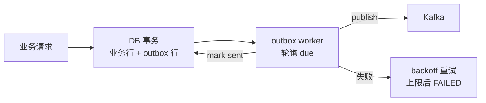

# 异步与幂等

Kafka（`kq`）、outbox、消费幂等、支付幂等、锁与限流。

## 什么时候走异步 `[主]`

- 非实时必需：对账、摘要、用量结算、内容审核、资产生成。
- 长耗时：分钟级生成、转码。只投递任务消息，执行落在专用 worker，不阻塞 queue 消费。

实时链路需要的结果，同步 RPC 拿；其余全部异步。

## Kafka 封装 `kq` `[主]`

仓库不直接用 kafka-go，统一走 `common/queue/kq`。链路：

```text
Pusher（各 RPC 服务的 biz/producer）→ Kafka Topic → app/queue（单个 Reader 订阅全部 topic）→ 按 msg.Topic 分发 → Handler
```

消息契约（结构体 + topic 常量）放 `common/mq`，生产者与消费者共用；序列化用 `sonic`。手机号等 PII 不进消息。

### topic 与环境隔离

- topic 带环境后缀：`{topic}_test` / `{topic}` / `{topic}_gray`，由各环境配置注入完整 topic 名。
- 新增 topic：先在规范里登记事件域与生产者，再在 `app/queue/biz/handler/handler.go` 的 `handlerFactories` 注册工厂。配置里出现未注册的 topic，`handler.Init()` 直接返回 error，进程退出。
- DLQ 统一一个 topic（`{project}.queue.dlq` + 同样的环境后缀），不是每个 topic 一个。配置里的 topic 后缀不一致时启动报错。

### 生产者

```go
pusher := kq.NewPusher(kq.ProducerConfig{
    Brokers:                brokers,
    Topic:                  topic,
    AllowAutoTopicCreation: true,
})
```

默认值零值即生效，不要显式重复：

| 项 | 默认 | 说明 |
|---|---|---|
| 模式 | 同步 | `Push` 阻塞到 broker ack，失败把错误返回调用方 |
| `RequiredAcks` | `all` | 等待全部 ISR 副本确认 |
| `Balancer` | `hash` | 相同 key 进相同分区；nil key 回退轮询 |
| `BatchLinger` | 5ms | 攒批等待，上限 100ms |
| `MaxAttempts` | 3 | kafka-go 默认 10 |
| `WriteTimeout` | 5s | kafka-go 默认 10s |

单次 `Push` 的最坏阻塞约为 `MaxAttempts × WriteTimeout`（默认 15s）。请求路径上的同步 Push 依赖这个上界，不要把两者同时调大。

| 方法 | 用途 |
|---|---|
| `Push(ctx, value)` | 不带 key，不保证与其他消息的顺序 |
| `PushWithKey(ctx, key int64, value)` | 相同 key 分区内有序（如按 `userId`） |
| `PushWithHeaders(ctx, key, value, headers)` | 带自定义头；空 key 按 nil 下发，不伪造 |
| `PushBatch(ctx, []Record)` | 一次写多条，同一分区内保持传入顺序；部分失败返回 `kafka.WriteErrors` |

业务事件一律同步模式。`WithAsyncPush(onError)` 只给埋点、非关键通知这类"失败只进回调"的场景，异步下 `Push` 立即返回，错误**不会**返回调用方。

生产者放在 `biz/producer/`，用 `sync.Once` 装配，`Stop()` 里 `Close()`。未配置 brokers/topic 的环境跳过初始化，发布调用降级为告警日志（返回 nil），不阻塞业务。

### 消费者

`app/queue` 用**一个 Reader 订阅全部 topic**，再按 `msg.Topic` 分发：

```go
queue, err := kq.NewQueue(kq.ConsumerConfig{
    Brokers:      brokers,
    Group:        group,
    Topics:       topics,
    Offset:       offset,
    DlqTopic:     dlqTopic,
    MaxRetries:   maxRetries,
    RetryBackoff: retryBackoff,
}, newTopicMessageHandler(topics), kq.WithFailureHandler(logFailure))
```

生命周期三段式，不要混：

```go
// handler.go —— Init 只注册，不启动
func Init() error { /* 校验配置、建 Queue、group.Add */ }
func Start()        { group.Start() } // 阻塞直到 Stop
func Stop()         { group.Stop() }  // 逆序停止、幂等

// main.go
if err := handler.Init(); err != nil { os.Exit(1) }
gopool.Go(handler.Start)
<-sig
handler.Stop()
```

新增 topic 只登记工厂，不要再单独 `gopool.Go(queue.Start)`。

Handler 只做三件事：反序列化 → 调领域 RPC → 返回 error：

```go
func (h *orderPaidMessageHandler) Handle(ctx context.Context, msg message.Message) error {
    var bizMsg mq.OrderPaidMsg
    if err := sonic.Unmarshal(msg.Value(), &bizMsg); err != nil {
        // 不要把 err 原样返回/打印：解析错误文本会带原始 JSON 片段（含用户正文）。
        return invalidMessageError("order_paid", msg.Value(), err)
    }
    _, err := rpc.InventoryClient.ReserveStock(ctx, &inventory.ReserveStockReq{
        RequestId: bizMsg.RequestId, /* ... */
    })
    return err
}
```

Handler 里不做业务逻辑，业务在领域服务里实现，这样 handler 天然是 `[glue]`。

### 失败语义：重试与 DLQ

| 情况 | 行为 |
|---|---|
| handler 返回 error | 进程内重试 `MaxRetries` 次，指数退避（`RetryBackoff × Multiplier^(i-1)`，向上抖动 `+Jitter`，封顶 `RetryMaxBackoff`） |
| handler 返回 `kq.Permanent(err)` | **不重试**，直接进失败分支 |
| handler panic | recover 后转 error，走同一条重试 / DLQ 路径，消费循环不中断 |
| 重试耗尽 | 原消息（含 topic/partition/offset/key/value 与错误信息）转投 `DlqTopic`，成功后提交 offset |
| `DlqTopic` 为空 | 不启用 DLQ：失败消息记录后提交跳过 |
| DLQ 转投失败 | 消息跳过（at-most-once）并经 errorHandler 上抛 |
| 停机中失败 | 不进 DLQ、不提交，留在原 offset，重启后重做 |

默认值：`ShutdownTimeout` 8s、`RetryMaxBackoff` 30s、`RetryMultiplier` 2.0、`RetryJitter` 0.2、`RetryBackoff` 500ms。`ShutdownTimeout` 必须小于容器的 `stop_grace_period`。

必然失败的错误（JSON 解析失败、缺幂等键、未知 topic）必须用 `kq.Permanent` 包装——重试多少次都不会成功，只会延迟进 DLQ 并占着分区。

`WithFailureHandler` 在重试耗尽时调用一次。`FailureInfo.DeadLettered=false` 表示消息即将丢失（未启用 DLQ 或转投失败），`app/queue` 打 `LOST` 日志供告警检索。

### 日志红线

- 日志不得带原始 JSON 消息体（含用户正文）。已进 DLQ 的消息只打元数据；只有消息即将丢失时才打印正文（此时它是唯一副本）。
- handler 自己也不要把带 payload 的解析错误直接返回或打印。

### 并发

`ConsumerConfig.Processors` 默认 0（inline：取一条、处理完、提交后再取下一条）。当前所有 topic 都是单分区，不建议开启；确需开启时 handler 必须幂等。

### DLQ 重放

`app/queue/cmd/replay` 只读 DLQ，目标 topic 只能来自信封且必须与 DLQ 环境后缀一致：

```bash
cd app/queue
go run ./cmd/replay -brokers <broker> -dlq-topic <dlq> -src-topic <topic> -dry-run
go run ./cmd/replay -brokers <broker> -dlq-topic <dlq> -src-topic <topic> -confirm
```

非 dry-run 必须显式 `-confirm`；`-limit` 默认 100、上限 1000。重放是 at-least-once，下游必须幂等。

## 事务性 outbox `[主]`

### 问题

"写业务数据"和"发 Kafka"是两个系统，无法在一个事务里完成。先写库再发消息，发送失败就丢事件；先发消息再写库，写库失败就发出假事件。

### 做法

把事件和业务数据写在**同一个本地事务**里，事件先落到 outbox 表，再由独立的 worker 投递：



```go
func (s *OrderStore) CreatePaidWithOutbox(ctx context.Context, order *Order, event OrderPaidMsg) (*Order, error) {
    err := s.db.WithContext(ctx).Transaction(func(tx *gorm.DB) error {
        if err := tx.Create(order).Error; err != nil {
            return err
        }
        payload, _ := json.Marshal(event)
        return tx.Create(&Outbox{
            EventID: "order-paid-" + order.RequestID, AggregateID: order.ID,
            Topic: OrderPaidTopic, Payload: string(payload), Status: "PENDING",
            NextRetryAt: time.Now().Add(time.Second),
        }).Error
    })
    return order, err
}
```

worker 只做四件事：取 due → 发 → 标记成功 → 失败则安排重试。参考参数 `[主]`：

| 参数 | 值 |
|---|---|
| 轮询间隔 | 1s |
| 批大小 | 100 |
| 首次延迟 | 1s |
| 最大重试 | 10 |
| 退避 | 30s × 次数 |

```go
func (w *outboxWorker) Run() {
    defer close(w.done)
    ticker := time.NewTicker(time.Second)
    defer ticker.Stop()
    for {
        w.processDue(context.Background())
        select {
        case <-w.stop:
            return
        case <-ticker.C:
        }
    }
}
```

用 `gopool.Go(worker.Run)` 启动，在 `ShutdownDeps` 里 `Stop()`。停机时正在处理的消息不进 DLQ、不提交，留在原 offset 等重启后重做。

outbox 是已落库业务事件的**唯一**发布路径，业务代码不直接发这类事件。

## 消费幂等 `[主]`

Kafka 至少投递一次，进程内重试和 rebalance 都会重复。消费端必须幂等：

- 用 `eventId` 或业务唯一键做去重表，或
- 让操作本身幂等（如 upsert、状态机只允许前进）。

消息里的业务 `RetryCount` 字段用于跨服务重投，与 `kq` 的进程内重试是两个层次，不要混用。

下游处理以 `request_id` 幂等：`SUCCEEDED` 直接返回历史结果；`PROCESSING` 未超过 10 分钟视为并发重复，直接返回成功；超过 10 分钟视为卡死并接管。新事件的幂等键照这个模式选一个业务上唯一的 ID，不要用 offset 或时间戳。

## 支付回调幂等 `[主]`

支付链路的三条规则：幂等键、行锁、状态机。

```go
func (s *PaymentStore) ApplyPayment(ctx context.Context, orderNo string) error {
    return s.db.WithContext(ctx).Transaction(func(tx *gorm.DB) error {
        // 1. 锁订单行
        var order PaymentOrder
        if err := tx.Clauses(clause.Locking{Strength: "UPDATE"}).
            Where("payment_no = ?", orderNo).First(&order).Error; err != nil {
            return err
        }
        // 2. 幂等键：同一订单只入账一次
        key := fmt.Sprintf("ORDER:%s:AMOUNT:AVAILABLE", order.PaymentNo)
        var existing Ledger
        err := tx.Where("idempotency_key = ?", key).First(&existing).Error
        if err == nil {
            return nil // 已入账，重复回调直接成功
        }
        if !errors.Is(err, gorm.ErrRecordNotFound) {
            return err
        }
        // 3. 状态机只允许前进
        res := tx.Model(&PaymentOrder{}).
            Where("payment_no = ? AND status = ?", orderNo, StatusPending).
            Updates(map[string]any{"status": StatusPaid, "paid_at": time.Now()})
        if res.Error != nil {
            return res.Error
        }
        if res.RowsAffected == 0 {
            return nil // 已被处理，并发回调
        }
        // 4. 锁余额账户、写账本、更新余额
        return s.creditBalance(tx, order, key)
    })
}
```

三个要素缺一不可：只有幂等键没有行锁，并发回调会同时通过检查；只有行锁没有状态机，乱序回调可能把已支付改回。

## 分布式锁 `[主]`

基于 Redis（`bsm/redislock`），包路径 `common/redislock`。在各服务 `main.go` 里 `redislock.InitLocker(redisClient)` 初始化后使用，防止同一资源的并发操作（重复提交、重复触发）：

```go
lock, err := redislock.Locker.Obtain(s.ctx, "lock:payment:"+orderNo, 30*time.Second, nil)
if err != nil {
    return nil, errno.NewBizError(errno.Err_ServiceErr, "请稍后再试")
}
defer lock.Release(s.ctx)
```

| API | 语义 |
|---|---|
| `Locker.Obtain(ctx, key, ttl, opts)` | 阻塞到拿到锁 |
| `ObtainWithRetry(ctx, key, ttl)` | 带重试获取，按 1s 线性重试 |
| `TryObtain(ctx, key, ttl)` | 只试一次：拿到 `(true, nil)`，被占 `(false, nil)`，Redis 故障 `(false, err)` |
| `TryObtainLock(ctx, key, ttl)` | 只试一次：拿到返回锁，被占 `(nil, nil)`，Redis 故障 `(nil, err)` |

锁 key 按**资源**命名，实际调用点的写法：`lock:login:{phoneHash}`、`lock:admin:{mobile}`。释放必须放在 `defer`。`TryObtainLock` 返回 `nil` 锁时不要 `defer lock.Release`，先判空。

## 限流 `[主]`

基于 Redis（`go-redis/redis_rate`），包路径 `common/ratelimit`，`main.go` 里 `ratelimit.InitLimiter(redisClient)` 初始化：

```go
if !ratelimit.AllowPerMinute(s.ctx, "admin:login:"+req.Mobile, 3) {
    return nil, errno.NewBizError(errno.Err_TooManyRequest, "请稍后再试")
}
```

`AllowPerMinute` / `AllowPerSecond` / `AllowPerHour` 三个入口，签名都是 `(ctx, key, rate) bool`。实际调用点的 key：`admin:login:{mobile}`、`admin:login:ip:{ip}`、`user:refresh:{userId}`。

敏感操作先限流再加锁（管理员登录就是先按 IP 按小时、再按手机号按分钟限流，然后加锁）。限流 key 的格式是 `{domain}:{action}:{dimension}:{id}`。（仓库规范里的 key 表与示例前后不一致，以代码为准。）

## 锁与限流不是幂等

锁保证同一时刻只有一个执行者；限流控制速率；幂等保证重复请求结果一致。三者解决不同问题，支付这类链路通常三者都要。
