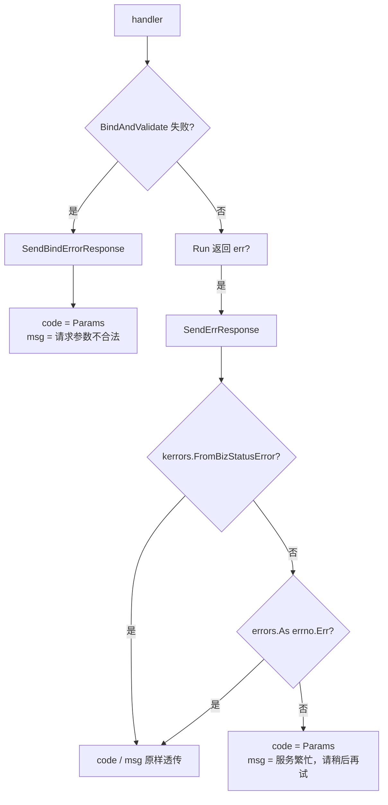
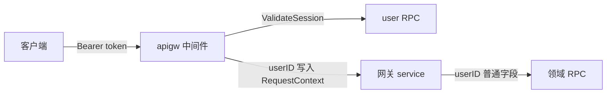

# 错误、认证与可观测

错误码怎么定、日志怎么选、身份和 request id 怎么传递。

## 错误码 `[主]`

错误码定义在 `idl/errno/errno.proto`，是一个 protobuf 枚举，用 `make gen-errno` 生成到 `rpc_gen/kitex_gen/errno`。所有服务共用同一份。

```protobuf
enum Err {
  // 成功
  Success = 0;
  // 路由未找到
  NoRoute = 1;
  // 方法不存在
  NoMethod = 2;
  // 参数错误
  Params = 10000;
  // 请求过多
  TooManyRequest = 10003;
  // 服务内部错误
  ServiceErr = 10004;
  // 网络超时
  NetworkTimeout = 10005;
  // 记录未找到
  RecordNotFound = 10007;
  // 记录已存在
  RecordAlreadyExist = 10008;
}
```

生成的 Go 名字带 `Err_` 前缀：`errno.Err_Params`、`errno.Err_RecordNotFound`。

业务错误码按域划分千位段，段内顺序递增：

| 段 | 域 | 段首 |
|---|---|---|
| `22xxx` | 短信 | `SmsInvalidArgument = 22001` |
| `23xxx` | 用户 | `UserInvalidArgument = 23001` |
| `24xxx` | 文件 | `FileInvalidArgument = 24001` |
| `25xxx` | 风控 | `RiskInvalidArgument = 25001` |
| `26xxx` | 计费（支付 + 充值 + 钱包） | `BillingInvalidArgument = 26001` |
| `27xxx` | 对话 | `DialogueInvalidArgument = 27001` |
| `28xxx` | 角色 | `CharacterInvalidArgument = 28001` |
| `29xxx` | 记忆 | `MemoryInvalidArgument = 29001` |
| `30xxx` | 管理员 | `AdminInvalidArgument = 30001` |

约定：

- 通用码在 `10000` 段，业务码不要往里加。
- 每个域第一个码是该域的参数错误（`{Domain}InvalidArgument`），之后是领域特有错误。
- 段的划分以**服务**为单位，不以业务对象为单位：支付、充值、钱包同属计费服务，共用 `26xxx`，不另开段。
- 新增错误码只追加，不复用、不重排。

每个域里几个有代表性的码，写业务时直接用，不要再造同义码：

| 码 | 用途 |
|---|---|
| `Err_UserTokenInvalid`（23005） | 用户端登录态无效；网关 `apigw` 的认证中间件失败固定回它 |
| `Err_AdminTokenInvalid`（30002） | 管理端登录态无效；`admingw` 认证中间件失败固定回它 |
| `Err_BillingPaymentStatusConflict`（26003）/ `Err_BillingRechargeStatusConflict`（26008） | 支付 / 充值订单状态机不允许的迁移（重复回调、乱序） |
| `Err_DialogueContentRejected`（27007） | 对话内容被风控拒绝 |
| `Err_CharacterDraftConflict`（28003）/ `Err_CharacterNameConflict`（28004） | 角色草稿版本冲突 / 名称重复 |
| `Err_MemoryStatusConflict`（29003） | 记忆状态不允许的迁移 |

## RPC 侧怎么返回错误 `[主]`

```go
// 业务错误：带稳定码和面向用户的文案
return nil, errno.NewBizError(errno.Err_RecordNotFound, "用户不存在")

// 内部错误：包装后向上，最外层决定映射
return nil, fmt.Errorf("failed to create user: %w", err)
```

跨层返回的错误必须带上下文（`%w` 包装）。不要把底层错误转成无信息的字符串，也不要把内部错误包装成 `Err_ServiceErr` 后丢掉原始信息——日志里需要能看到根因。

## 网关侧怎么映射 `[主]`

网关的错误响应有两个入口，**按错误来自哪个分支选，不按错误内容猜**：



| 入口 | 用在哪 | 兜底 |
|---|---|---|
| `SendBindErrorResponse` | `c.BindAndValidate` 失败 | 固定 `Err_Params` + "请求参数不合法" |
| `SendErrResponse` | `service.Run` 返回错误 | 非业务错误 `Err_Params` + "服务繁忙，请稍后再试" |

要点：

- HTTP 状态恒为 200，结果在 JSON 的 `code` 里。
- 业务错误保留 RPC 侧的码与文案；其余错误对客户端只有"服务繁忙"，不向前端泄露内部信息，原始错误写 `hlog.CtxErrorf`。
- 绑定错误一定要走 `SendBindErrorResponse`。Hertz 的绑定错误是 `fmt.Errorf` 出来的无类型错误，`errors.As` 识别不了；把它送进 `SendErrResponse` 会被报成"服务繁忙"，客户端以为是服务端故障。
- 认证中间件失败也走 `SendErrResponse`，但传入的是自造的 `errno.NewBizError(errno.Err_UserTokenInvalid, "登录状态无效")`，所以是业务错误透传。

## 日志选型 `[主]`

| 服务类型 | 日志库 | import |
|---|---|---|
| RPC 服务 | `klog` | `github.com/cloudwego/kitex/pkg/klog` |
| 网关 | `hlog` | `github.com/cloudwego/hertz/pkg/common/hlog` |

不要混用：网关里用 `klog` 会绕开 Hertz 的 logger 配置。

## 必须带上下文 `[主]`

```go
// ✅ 带 ctx：trace id、request id 自动注入
klog.CtxErrorf(s.ctx, "create order failed: request_id=%s err=%v", req.GetRequestId(), err)
hlog.CtxErrorf(s.Context, "rpc error: %v", err)

// ❌ 不带 ctx：无法与请求关联
klog.Errorf("error: %v", err)
```

## request id `[主]`

请求 ID 是网关中间件，不再由业务代码生成。`mw.NewAccessLog()` 返回的两个中间件里第一个就是它：

```go
const RequestIDHeader = "X-Request-Id"

func RequestID(c *app.RequestContext) string {
    value := string(c.GetHeader(RequestIDHeader))
    if isValidRequestID(value) {
        return value
    }
    return newRequestID(value)
}
```

规则：

- 客户端带了 `X-Request-Id` 且合法就沿用；否则生成 `uuid.NewString()`。合法 = 非空、长度 ≤ 64、只含 `[A-Za-z0-9-_.]`。
- 中间件把最终 ID 回写**请求头与响应头**，所以 `RequestID(c)` 直接读请求头即可；没经过中间件的路径也按同一规则兜底。
- 访问日志同一行带 request id、状态码、耗时、method、path、query、IP、**IP 归属地**（`ipLocation=`）、UA、`platform` / `deviceId` / `appVersion`、`ctype` 和脱敏后的请求/响应体，所有网关请求自动有这一行，业务代码不用再打入口日志。
- 归属地由 `iplocator.Location(ip)` 查离线库得到，查不到填"未知"；访问日志**不再**输出 `X-Forwarded-For`（`xff=`）——客户端 IP 统一由 `mw.ClientIP` 解析，日志只记解析结果。

RPC 请求消息里声明 `string requestId = 1;`，网关填入，各服务透传给下游。所有跨服务的日志靠它串联。

访问日志里的请求体/响应体经 `logx.FormatJSONPayload` 脱敏并截断（请求 2048、响应 512 字节）。用户正文这类内容不要在业务日志里原样打印。

## 身份传递 `[主]`



- 网关请求体不声明 `accessToken`。
- 领域 RPC 不接收 token，只接收 `userId`。
- 例外：`ValidateSession` 本身，以及登录/刷新的响应。
- 管理端是 `admingw` 的 `MustAdminLogin` → `admin.ValidateAdminToken`，业务取 `mw.AdminID(c)`；失败回 `Err_AdminTokenInvalid`。

## 外部模型调用日志 `[主]`

调用外部模型（生成、语音、向量化等按用量计费的服务）的日志必须带 `model version`、`request id`、`prompt_tokens`、`completion_tokens`、`latency`，用于成本追踪和问题定位：

```go
klog.CtxInfof(s.ctx,
    "order stream completed: request_id=%s model=%s deltas=%d prompt_tokens=%d completion_tokens=%d latency_ms=%d",
    req.GetRequestId(), modelName, seq, promptTokens, completionTokens, latencyMs)
```
