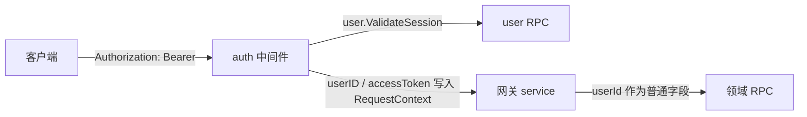

# Hertz 网关

网关 service 怎么写、身份怎么传、响应怎么统一、公共代码放哪。

## 网关只做四件事 `[主]`

解析并校验登录态 → 路由 → 把 HTTP 类型 pack 成 RPC 类型 → 调领域 RPC。不直连数据库，不写领域规则，不持有表。

## 公共代码：`hcommon/` 与 `common/` 的边界 `[主]`

网关的公共代码放独立 module `hcommon/`，`apigw` 与 `admingw` 共用。边界只有一条：**`common` 服务于 Kitex RPC，不引入 Hertz 依赖；凡是 import 了 `github.com/cloudwego/hertz` 的公共代码放 `hcommon`**。

| 包 | 内容 |
|---|---|
| `hcommon/pkg/pbjson` | 纯编解码：信封 wire 契约、protojson 编解码、`Encoder` 池、SSE 事件编码 |
| `hcommon/pkg/responsex` | 统一响应信封、请求绑定配置（protojson）、错误分类 |
| `hcommon/pkg/mw` | 请求 ID、访问日志、客户端 IP、Bearer 解析、CORS |

网关里不要再出现 `biz/utils/`（响应信封）和 `biz/mw/{accesslog,clientip,cors}.go` 这类自写副本，它们已经全部抽到 `hcommon`。网关自己的 `biz/mw/auth.go` 只保留与该网关身份模型绑定的部分。

**网关配置包是例外，留在各网关本地 `app/{gw}/conf/`**，不要抽到 `hcommon`：`hz` 生成的代码按 `<module>/conf` 固定路径引用它，抽走会让重新生成失败。`conf.GetConf()` / `conf.GetEnv()` / `conf.LogLevel()` 三个入口；`GO_ENV` 为空默认 `test`。

## 方法形状 `[主]`

生成的 handler 委托给 `service.New{Method}Service(ctx, c).Run(&req)`，service 桩的构造函数带 `*app.RequestContext`：

```go
type GetUserService struct {
    RequestContext *app.RequestContext
    Context        context.Context
}

func NewGetUserService(ctx context.Context, c *app.RequestContext) *GetUserService {
    return &GetUserService{RequestContext: c, Context: ctx}
}

func (s *GetUserService) Run(req *gwuser.GetUserReq) (*gwuser.GetUserResp, error) {
    resp, err := rpc.UserClient.GetUser(s.Context, &rpcuser.GetUserReq{
        UserId: mw.UserID(s.RequestContext),
    })
    if err != nil {
        return nil, err
    }
    return pack.GetUserResp(resp), nil
}
```

身份从 `mw.UserID(s.RequestContext)` 取——它由中间件写入，service 不解析 token、不调 `ValidateSession`。网关请求体**不声明** `accessToken`；领域 RPC **不接收** token，只接收 `userId`。

需要把调用方环境传给下游时，用 `support.go` 里的 `clientInfo(c)` 组装 `ClientInfo`（IP 走 `hmw.ClientIP`，其余来自 `deviceId` / `platform` / `appVersion` / `deviceModel` / `registerSource` 头）。

> 存量代码里有个别路由的中间件仍是 `return nil` 桩，对应的 service 各自在 `Run` 里调 `validateRequestSession`。这是未迁移完的遗留，新端点按"中间件 + `mw.UserID`"写，不要复制这段。

## 认证在中间件完成，业务拿已验证的身份 `[主]`



```go
func MustLogin() app.HandlerFunc {
    return func(ctx context.Context, c *app.RequestContext) {
        token := hmw.BearerToken(string(c.GetHeader("Authorization")))
        if token == "" {
            abortLoginRequired(ctx, c)
            return
        }
        session, err := rpc.UserClient.ValidateSession(ctx, &rpcuser.ValidateSessionReq{AccessToken: token})
        if err != nil || session.GetUserId() <= 0 {
            abortLoginRequired(ctx, c)
            return
        }
        c.Set(authenticatedUserIDKey, session.GetUserId())
        c.Set(accessTokenKey, token)
    }
}
```

`hmw.BearerToken` 对 `Bearer` 前缀大小写不敏感，没有前缀时按裸 token 处理。失败统一回 `Err_UserTokenInvalid`（文案"登录状态无效"）并 `Abort`，不区分"没带 token""token 过期""RPC 失败"，避免给探测者信息。`admingw` 对应 `MustAdminLogin` / `mw.AdminID(c)`。

把中间件挂到路由上：改 `biz/router/{pkg}/middleware.go` 里对应的 `_{method}Mw()`，这是生成器留给用户的扩展点，重新生成不会覆盖：

```go
func _getuserMw() []app.HandlerFunc {
    return mw.MustLoginMw()
}
```

## 启动顺序 `[主]`

```go
rpc.InitClient()
if err := iplocator.Init(conf.GetConf().Ip2region.DbPath); err != nil {
    hlog.Warnf("init ip locator failed, ipLocation disabled: %v", err)
}
h := server.New(
    server.WithBindConfig(responsex.BindConfig()),
    server.WithHostPorts(conf.GetConf().Hertz.Address),
    server.WithMaxRequestBodySize(conf.GetConf().Hertz.MaxRequestBodyBytes),
)
h.SetClientIPFunc(mw.ClientIP)
h.Use(mw.NewAccessLog()...)
h.Use(mw.NewCORS()...) // 仅 admingw
register(h)
h.Spin()
```

`WithBindConfig` 不能漏，否则请求体不走 protojson（见下文）。

`main.go` 头部带 `Code generated by hertz generator.` 但 `update_behavior` 是 skip，首次生成后由项目维护：日志写 stdout + lumberjack 轮转文件（`log/hertz.log`，100MB、保留 3 份、7 天），`hlog.SetLevel(conf.LogLevel())` 在 `server.New` 之前。

## 响应信封：`responsex` + `pbjson` `[主]`

信封由两层组成，职责分开：

| 层 | 位置 | 职责 |
|---|---|---|
| `responsex` | `hcommon/pkg/responsex` | 三个入口函数 + 错误分类 + 绑定配置；依赖 Hertz |
| `pbjson` | `hcommon/pkg/pbjson` | 纯编码器：信封 wire 契约、protojson 编解码、`Encoder` 池；不依赖 Hertz |

`pbjson` 只在 `hcommon` 里，`common/` 下没有它。它不 import Hertz，但服务的是网关 HTTP wire 语义，所以归网关公共库；不要把它移回 `common`。

### 三个入口

```go
// 成功：data 用 protojson 编码进信封
func SendSuccessResponse(ctx context.Context, c *app.RequestContext, _ int, data any)

// 业务分支的错误：业务错误原样透传，其余一律"服务繁忙"
func SendErrResponse(ctx context.Context, c *app.RequestContext, _ int, err error)

// 绑定分支的错误：一定来自客户端，固定参数错误
func SendBindErrorResponse(ctx context.Context, c *app.RequestContext, err error)
```

| 入口 | handler 里的位置 | `err` 来源 | 响应 |
|---|---|---|---|
| `SendSuccessResponse` | `Run` 成功后 | — | `code=0, msg="OK", data=<protojson>` |
| `SendErrResponse` | `Run` 返回 err | RPC 错误、网关 service 自造的 `errno.NewBizError` | 业务错误保留原码原文案；非业务错误 `Err_Params` + "服务繁忙，请稍后再试" |
| `SendBindErrorResponse` | `c.BindAndValidate` 失败 | JSON 非法、类型不符、缺参 | 固定 `Err_Params` + "请求参数不合法" |

要点：

- HTTP 状态恒为 200，业务结果在 `code` 里。生成的 handler 把 `consts.StatusOK` / `consts.StatusBadRequest` 传进来，信封函数**忽略**第三个参数。
- 业务错误识别两条路：`kerrors.FromBizStatusError`（RPC 传来的）→ `errors.As(err, &errno.Err)`（网关本地的，含 wrapped）。
- **`SendErrResponse` 的兜底不再看错误文案**。RPC 超时、连接失败、服务内部错误对客户端一律是"服务繁忙"，原始错误只进日志，不透给前端。
- 编码失败（`data` 无法序列化）时回 `Err_ServiceErr` + "服务繁忙，请稍后再试"。

`pbjson` 的实现要点：信封头尾（`code` / `msg` / `timestamp`）直接拼进同一块缓冲，`data` 用 `protojson.MarshalOptions{EmitUnpopulated: true}.MarshalAppend` 追加，避免二次序列化；`Encoder` 走 `sync.Pool`，超过 64KB 的缓冲不回收。`timestamp` 是字符串形式的 Unix 秒。`data` 为 `nil` 或类型化 nil 时输出 `null`；非 proto 类型回退标准库 `encoding/json`。`MarshalEvent` 用 protojson 默认选项（不补零值），给 SSE 事件用。

### wire 契约

```json
{"code":0,"msg":"OK","data":{...},"timestamp":"1795784761"}
```

- `code` 是数字；成功恒为 `0`，错误时 `data` 为 `null`。
- `timestamp` 是**字符串**形式的 Unix 秒（`int64` 按 protojson 规则输出为字符串）。
- `data` 按 **protojson** 编码：`int64` 字段输出字符串、零值字段保留（`EmitUnpopulated`）、未赋值的嵌套消息为 `null`。不是 `encoding/json` + `omitempty` 的形态。
- `Content-Type: application/json; charset=utf-8`。

### 请求绑定同样走 protojson

`responsex.BindConfig()` 返回进程级单例的 `binding.BindConfig`，把 `c.BindAndValidate` 的 JSON body 解码器换成 `pbjson.UnmarshalProto`：

- `int64` 字段**同时接受**字符串与数字，前端不必为了 ID 做字符串化处理。
- 未知字段忽略（`DiscardUnknown`），老客户端多传字段不会报错。
- 非 proto 目标回退 Hertz 原有解码器。
- 只覆盖 `c.BindAndValidate`；`c.BindJSON` 走 `NewDecoder`，不在范围内，所以网关请求统一用 `BindAndValidate`（生成的 handler 本来就是这样）。

`UseThirdPartyJSONUnmarshaler` 替换的是 Hertz 包级解码器，天然全局生效，所以 `BindConfig` 用 `sync.Once` 只安装一次、返回同一个实例。

## service 层直接返回错误 `[主]`

```go
// ✅ service 返回 error，handler 的统一函数决定响应
return nil, err

// ❌ service 自己写 HTTP 响应
c.JSON(http.StatusOK, ...)
```

service 不碰信封，也不决定状态码。这样同一份 service 可以被 handler、测试、其他入口复用。

## pack：显式转换，不反射 `[主]`

网关类型（`hertz_gen/gw/...`）与 RPC 类型（`rpc_gen/kitex_gen/...`）是两个独立生成的集合，字段相似但不是同一类型。用 `biz/pack/` 下的手写函数转换：

```go
func ToRPCInputParts(parts []*gworder.InputPart) []*rpcorder.InputPart {
    out := make([]*rpcorder.InputPart, 0, len(parts))
    for _, p := range parts {
        out = append(out, &rpcorder.InputPart{
            Type: p.GetType(), Text: p.GetText(), FileId: p.GetFileId(),
        })
    }
    return out
}
```

新增字段时编译器不会提醒你补 pack，这是手写转换的代价，换来的是两侧可以独立演进。加字段时在同一个提交里补 pack 并手工验证。

## request id `[主]`

请求 ID 由 `mw.NewAccessLog()` 里的中间件统一处理，业务代码不再自己写 `requestID()`：

- 读请求头 `X-Request-Id`；合法则沿用，否则生成 `uuid.NewString()`。合法 = 非空、长度 ≤ 64、只含 `[A-Za-z0-9-_.]`。
- 中间件把最终 ID **回写请求头与响应头**，客户端从响应头拿它去查日志。
- 业务取值用 `hmw.RequestID(c)`，作为 RPC 字段下传。

详见 [errors-auth-observability.md](errors-auth-observability.md)。
