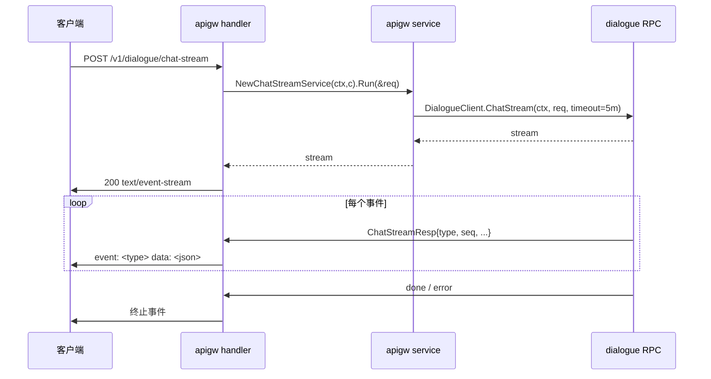

# 流式与 SSE

Kitex server-streaming 到 Hertz SSE 的全链路。

## 链路 `[主]`



网关 IDL 声明的是**普通 unary** 方法；流式语义由 handler 里的桥接实现。RPC IDL 用 server-streaming。

## RPC 侧 `[主]`

### 第一行用 stream.Context()

生成的 handler 骨架硬编码了 `ctx := context.Background()`，不透传请求上下文。`Run` 必须用 stream 的上下文覆盖：

```go
func (s *ChatStreamService) Run(req *dialogue.ChatReq, stream dialogue.DialogueService_ChatStreamServer) error {
    // 流式 handler 的生成骨架不透传请求 ctx；连接生命周期以 stream.Context() 为准。
    s.ctx = stream.Context()
```

不做这一步，客户端断开、超时、trace 都与连接脱钩。

### 事件协议 `[主]`

`ChatStreamResp` 用 `type` 区分事件，`seq` 从 1 单调递增，每个事件携带同一个 `replyId`：

| type | 含义 | 终止 |
|---|---|---|
| `transcript` | 用户输入的识别文本 | |
| `delta` | 模型输出分片 | |
| `audio` | 语音分片 | |
| `done` | 正常完成，带用量与终态 | 是 |
| `error` | 业务或模型错误 | 是 |

### 业务错误编码为 error 事件 `[主]`

流一旦建立，就不能再用 RPC 错误表达业务失败——那会让客户端只看到传输层断流。所有失败都发 `error` 事件后正常返回 `nil`：

```go
func (s *ChatStreamService) sendErrorEvent(
    stream dialogue.DialogueService_ChatStreamServer, replyID string, seq int64, code errno.Err, message string,
) error {
    return stream.Send(&dialogue.ChatStreamResp{
        Type: "error", ReplyId: replyID, Seq: seq + 1, Code: int32(code), Message: message,
    })
}
```

只有 `stream.Send` 本身失败（客户端已断开）才返回非 nil error。

### 幂等重放 `[主]`

请求带 `clientMessageId`。先查是否已有同 id 的已定稿轮次，有则重放缓存回复，不再调模型：

```go
cached, err := findIdempotentTurn(s.ctx, req)
if err != nil {
    return s.sendErrorEvent(stream, "", 0, errno.Err_ServiceErr, "failed to load dialogue turn")
} else if cached != nil {
    return s.sendCachedReply(stream, req, cached)
}
```

## 网关侧 `[主]`

### service 建立流并设置独立超时

流式 RPC 的耗时不属于普通 unary 的量级，必须单独设：

```go
const chatStreamRPCTimeout = 5 * time.Minute

func (s *ChatStreamService) Run(req *gwdialogue.ChatReq) (dialogueservice.DialogueService_ChatStreamClient, error) {
    session, err := validateRequestSession(s.Context, s.RequestContext, requestID(s.RequestContext))
    if err != nil {
        return nil, err
    }
    return rpc.DialogueClient.ChatStream(s.Context, &rpcdialogue.ChatReq{
        RequestId:       requestID(s.RequestContext),
        UserId:          session.GetUserId(),
        CharacterId:     req.GetCharacterId(),
        ClientMessageId: req.GetClientMessageId(),
    }, callopt.WithRPCTimeout(chatStreamRPCTimeout))
}
```

`Run` 的返回值是 stream 对象，不是响应消息。

### handler 桥接 `[主]`

这是 [generated-code-boundary.md](generated-code-boundary.md) 登记的唯一例外。handler 里把 JSON 收尾换成桥接调用：

```go
stream, err := service.NewChatStreamService(ctx, c).Run(&req)
if err != nil {
    utils.SendErrResponse(ctx, c, consts.StatusBadRequest, err)
    return
}
writeSSEStream(c, stream)
```

桥接函数写在同包的 `sse.go`：

```go
// cloudwego-skills: sse-bridge ChatStream — registered exception, see references/generated-code-boundary.md
func writeSSEStream(c *app.RequestContext, stream dialogueservice.DialogueService_ChatStreamClient) {
    c.SetStatusCode(consts.StatusOK)
    c.Response.Header.Set("Content-Type", "text/event-stream")
    c.Response.Header.Set("Cache-Control", "no-cache")
    c.Response.Header.Set("Connection", "keep-alive")
    c.Response.Header.Set("X-Accel-Buffering", "no")
    sseStream := sse.NewStream(c)

    for {
        event, recvErr := stream.Recv()
        if errors.Is(recvErr, io.EOF) {
            break
        }
        if recvErr != nil {
            code, message := errno.Err_DialogueModelUnavailable, "model stream interrupted"
            if bizErr, ok := kerrors.FromBizStatusError(recvErr); ok {
                code, message = errno.Err(bizErr.BizStatusCode()), bizErr.BizMessage()
            }
            publish(sseStream, &dialoguepb.ChatStreamResp{Type: "error", Code: int32(code), Message: message})
            break
        }
        if event == nil {
            continue
        }
        if err := publish(sseStream, event); err != nil {
            break
        }
        if event.Type == "done" || event.Type == "error" {
            break
        }
    }
    c.Flush()
}
```

### 零值字段不能丢 `[主]`

protobuf 生成的 struct 带 `omitempty`，值为零的字段序列化时会消失。`partIndex=0` 是合法且常见的值（第一个分段），丢了会让前端错位。对这类字段用显式 DTO 包装：

```go
type deltaEvent struct {
    Type      string `json:"type"`
    ReplyID   string `json:"replyId"`
    Seq       int64  `json:"seq"`
    Text      string `json:"text"`
    PartType  string `json:"partType"`
    PartIndex int32  `json:"partIndex"`   // 无 omitempty，0 也会输出
}
```

逐个检查流式消息里"零值有意义"的字段，不要等到前端报错。

## 常见错误

| 现象 | 原因 | 修法 |
|---|---|---|
| 客户端断开后模型仍在跑 | 没用 `stream.Context()` | `Run` 第一行覆盖 `s.ctx` |
| 出错时客户端只看到连接关闭 | 业务错误走了 RPC error | 改发 `error` 事件后 `return nil` |
| 长回复中途断 | 用了默认 RPC 超时 | `callopt.WithRPCTimeout(5*time.Minute)` |
| 首个分片下标丢失 | `omitempty` 吃掉了 0 | 用显式 DTO |
| 重新生成后 SSE 不工作 | 桥接被覆盖 | 按 [generated-code-boundary.md](generated-code-boundary.md) 恢复 |
